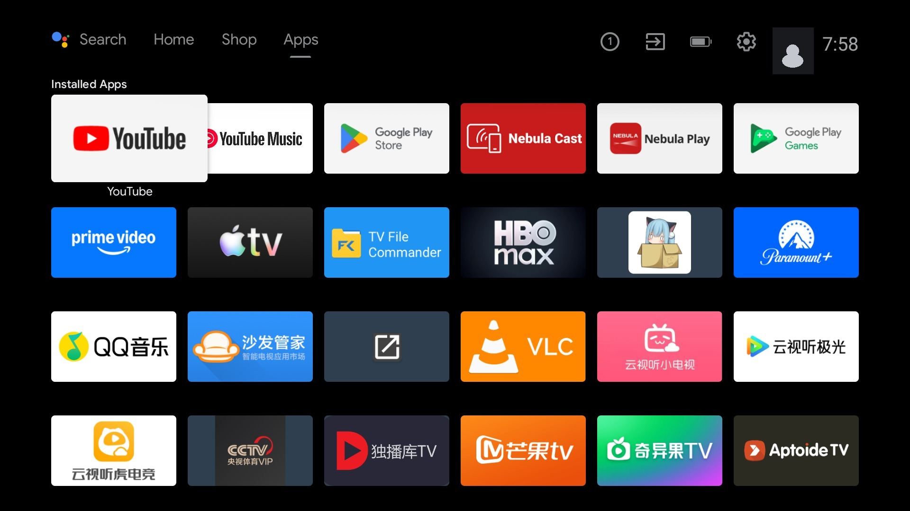
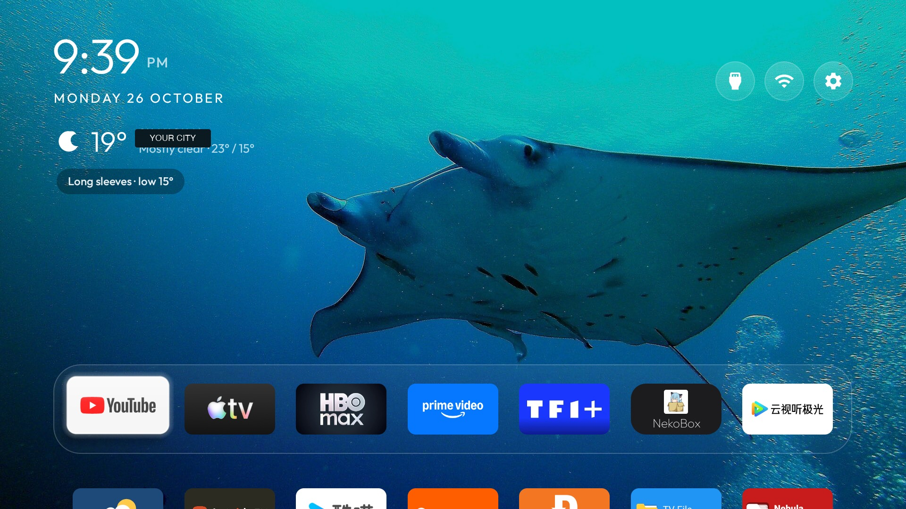

# Nebula Clean TV

An ad-light, Apple TV-style home screen for the **Anker Nebula Capsule III Pro (D2426)**, running **Android 11 / SDK 30**.

The project removes the noisy stock launcher and recommendation services, installs a custom Android TV launcher, applies a calm blue manta-ray theme, and adds a local weather widget under the clock. It is **reversible**: packages are disabled, not uninstalled, and a backup is taken before anything changes.

Built and verified with **DeepSeek V4.1 Flash via opencode** as the engineering assistant. The model handled ADB discovery, package analysis, source changes, Gradle builds, on-device verification, and the documentation you are reading. No private device data, account data, VPN configuration, or credentials are included.

| Before | After |
| --- | --- |
|  |  |

The profile avatar and city label in the screenshots were redacted.

## What changed

### 1. Debloat and ad cleanup

Nine packages are disabled for user 0, never uninstalled. The list targets telemetry, feedback, partner auto-install, retail demo content, Google Assistant (owner choice), and the stock launcher/recommendation stack.

The following were deliberately **kept**: Chromecast, AirPlay/AirPin, firmware updates, Ambient screensaver, Play Games, TalkBack, and all installed streaming/VPN apps.

The exact list is in [`debloat.txt`](debloat.txt).

### 2. New Home screen

- Launcher: [`com.gathin.tvhome`](https://github.com/Gathin23/cleanyourtv)
- Stock Home `com.google.android.tvlauncher` disabled only after the new launcher was verified
- Seven-app frosted dock, seven columns, no rows below the dock, no greeting
- App library retained
- Hidden system TV center panel
- Single wallpaper, no rotation

### 3. Theme: `nebula-coast`

A blue side-view manta-ray wallpaper with a glass dock:

- YouTube
- Apple TV
- HBO Max
- Prime Video
- TF1+
- NekoBox
- Tencent / 云视听极光

The wallpaper is **“Manta in German Channel Palau” by amanderson2, CC BY 2.0**. See [`theme/nebula-coast/CREDITS.md`](theme/nebula-coast/CREDITS.md).

### 4. Weather under the clock

A local-only weather header was added to the launcher:

- The Weather add-on fetches the forecast.
- The add-on exposes a **read-only, exported provider** at `content://io.github.sumyabazar1.weather.current/current`.
- The launcher has **no INTERNET permission**; it only reads the latest cached reading.
- Refresh interval: 30 minutes.
- Shows city, current temperature, condition, high/low, a clothing tip, and a sun/moon icon for clear skies.
- If the Weather app has no city or no reading, the widget stays hidden.

See [`docs/04-weather-widget.md`](docs/04-weather-widget.md) and the patches in [`patches/`](patches/).

## Requirements

- Anker Nebula D2426 / Capsule III Pro (or a closely related Android TV device)
- Android 11 / SDK 30 for the tested build
- ADB over the local network, authorized on the projector
- A Mac/Linux machine with:
  - JDK 17
  - Android SDK platform 34 and build-tools 34.0.0
  - Python 3
- [`Gathin23/cleanyourtv`](https://github.com/Gathin23/cleanyourtv), the upstream toolkit this project builds on

## Quick start

> Replace `<PROJECTOR_IP>` with the address shown in the projector's developer options. Keep backups and generated files out of this repository.

```bash
git clone https://github.com/Gathin23/cleanyourtv.git
cd cleanyourtv

python3 -m venv tools/venv
tools/venv/bin/pip install -r tools/requirements.txt

export TV_HOST=<PROJECTOR_IP>
tools/venv/bin/python -I tools/tv.py 'getprop ro.build.version.sdk'
```

### 1. Back up before changing anything

Follow [`docs/01-safety-and-backup.md`](docs/01-safety-and-backup.md). At minimum, record installed/disabled packages, Home, Wi-Fi ownership, settings, and a screenshot. Keep that backup private.

### 2. Debloat

```bash
TV_HOST=<PROJECTOR_IP> tools/disable.sh /path/to/nebula-clean-tv/debloat.txt
```

The upstream script refuses package names that are not valid, refuses core Android packages, and protects the setup wizard that owns the saved Wi-Fi network.

### 3. Build and install the launcher

```bash
cd launcher
TV_HOST=<PROJECTOR_IP> ./build-and-install.sh
```

The script builds the APK, installs it, starts it, checks that it really started, and only then disables the stock launcher. If anything fails, it leaves the stock Home alone.

### 4. Add the weather widget

From the `cleanyourtv` root:

```bash
git apply /path/to/nebula-clean-tv/patches/weather-addon.patch
git apply /path/to/nebula-clean-tv/patches/launcher-weather.patch
```

Then build both apps:

```bash
cd addons/weather
./gradlew assembleRelease
cd ../..

cd launcher
TV_HOST=<PROJECTOR_IP> ./build-and-install.sh
cd ..
```

Install the Weather add-on:

```bash
TV_HOST=<PROJECTOR_IP> tools/venv/bin/python -I tools/tv.py \
  --push addons/weather/app/build/outputs/apk/release/app-release.apk /data/local/tmp/weather.apk

TV_HOST=<PROJECTOR_IP> tools/venv/bin/python -I tools/tv.py \
  'pm install -r /data/local/tmp/weather.apk; rm -f /data/local/tmp/weather.apk'
```

Open **Weather**, search for a city, and select it once. The launcher will pick up the cached reading on its next refresh or after returning Home.

### 5. Apply the theme

```bash
TV_HOST=<PROJECTOR_IP> tools/theme.sh /path/to/nebula-clean-tv/theme/nebula-coast
```

### 6. Verify

Use [`scripts/verify.sh`](scripts/verify.sh) or the manual commands in [`docs/05-verify-and-restore.md`](docs/05-verify-and-restore.md).

Expected:

- Home resolves to `com.gathin.tvhome/.MainActivity`
- Nine packages are disabled
- The weather provider returns one row when a city is configured
- The weather widget is visible under the date
- The Home button opens the new launcher after a reboot

## Repository layout

```text
.
├── debloat.txt                 exact package list used
├── docs/                       setup, rationale, verification, scope
│   ├── assets/                 sanitized before/after screenshots
│   ├── 01-safety-and-backup.md
│   ├── 02-debloat.md
│   ├── 03-launcher-and-theme.md
│   ├── 04-weather-widget.md
│   ├── 05-verify-and-restore.md
│   ├── 06-scope-and-privacy.md
│   └── 07-deepseek-workflow.md
├── patches/                    unified diffs against cleanyourtv
├── source/                     changed source files for reference
├── theme/nebula-coast/         live theme + wallpaper
└── scripts/                    helper scripts (no device data)
```

## Restore

The short version:

```bash
TV_HOST=<PROJECTOR_IP> tools/restore.sh /path/to/nebula-clean-tv/debloat.txt com.google.android.tvlauncher
```

Then uninstall the launcher and Weather add-on if desired. The full procedure, including the stock screensaver and Home component, is in [`docs/05-verify-and-restore.md`](docs/05-verify-and-restore.md).

## Limitations and non-goals

- **No Netflix workarounds.** The current Android TV Netflix app rejects this projector with device-certification error `-13`; the older Android TV build that launches cannot reach the current service (`-121`). The only working Netflix build on this device is the phone/tablet app, which is not remote-first. No Netflix APK, patch, account data, or bypass is included.
- The debloat list is specific to this device/firmware. Review it before using it on another model.
- This is not root, not a custom ROM, and not a system-image modification.
- App logos and trademarks belong to their owners. The screenshots are documentation, not an endorsement.
- The theme's wallpaper is **CC BY 2.0**, separate from the MIT-licensed code and documentation.

## Credits

- [Gathin23/cleanyourtv](https://github.com/Gathin23/cleanyourtv) — upstream launcher, debloat toolkit, theme format, and Weather add-on (MIT)
- [Sumyabazar1](https://github.com/Sumyabazar1) — Weather add-on author
- “Manta in German Channel Palau” by **amanderson2**, CC BY 2.0, via Wikimedia Commons
- DeepSeek V4.1 Flash via opencode — engineering assistant

See [`NOTICE.md`](NOTICE.md) and [`UPSTREAM.md`](UPSTREAM.md) for details.

## License

Code and documentation in this repository are released under the **MIT License**. The wallpaper remains CC BY 2.0. Upstream files remain under their original licenses.
